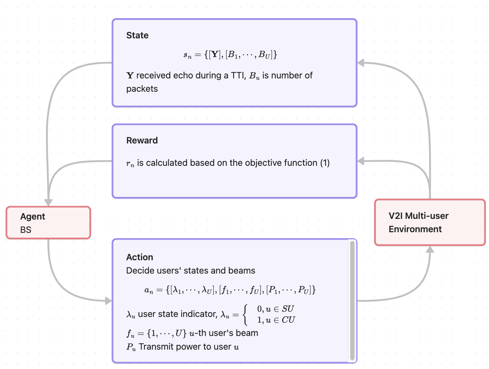

<!-- ## Before discussion
Traffic mode is using a simple Bernoulli distribution
$$
    \text{Tr}_{u} = \text{Bernoulli}(Pr_u)
$$

The objective function was formulated as 
$$
\begin{alignat}{2}
&\underset{P_{u,n}, \lambda_{u,n}, \boldsymbol{f}_{u,n}}{\arg \max} ~~  && \sum_{n=1}^{\text{TTI}} \sum_{u=1}^U  \Big( \lambda_{u,n} \text{Tr}_{u,n} R_{u,n}  +  (1-\lambda_{u,n})(1-\text{var}^{no}(\hat{\varphi}_{q,n})) -  \text{buffer penalty}
\Big) \nonumber\\
&\mathrm{subject~to} ~~ &&\sum_{u=1}^U P_{u,n} \leq P \nonumber \\
& &&\lambda_{u,n} \in\{0,1\} ~~ \text{user's state: 1 CU, 0 SU}\nonumber\\
& && \text{Tr}_{u,n} \in \{0,1\} ~~ \text{1: a packet is generated for $u$}\nonumber\\
& && R_{u,n} = \log_2(1+\gamma_{u,n}) = \log_2(1+ \frac{P_{u.n}|\boldsymbol{h}_u ^H \boldsymbol{f}_{u,n} |^2}{\sigma_{\omega}^2}) \nonumber\\
& && \text{var}^{no}(\hat{\varphi}_{q,n}) ~~ \text{normalized MSE,} ~~~ \text{var} (\hat{\varphi}_{q,n}) \propto \frac{\sigma_{\omega}^2}{\kappa^2 P_{q,n} \beta^2_{q,n} \big|\boldsymbol{a}^H (\varphi_q) \boldsymbol{f}_{q,n}\big|^2 \Delta T } \nonumber
\end{alignat}
$$

There were two problems:

- I was not sure how to add the buffer panelty which has memory and will affect the future time slot. The buffer penalty was set as $|\text{Tr}_{u,n} - \lambda_{u,n}|$ such that a user should be communication user when a packet comes. However, this formulation does not have memory. It will not affect future or get information from the past.

-  I defined $Tr_{u,n}$. Ideally, there is no packet, it should focus on sensing. However, it didn't cover the case when no new packet comes, but the buffer is not empty. -->

## Last week
- The buffer definition is not affected by the past and will not affect the future. 

- The communication part in the objective function: communication rate is not the final goal 

### Changes
- We consider the buffer by assuming that packets for a user are generated before a frame which contains $N$ TTIs. Let $[B_{1,0}, \cdots, B_{U,0}]$ be the vector of packet number in the buffer of each user in the beginning of the frame. 

- The communication part should not be the rate $R_{u,n}$. Instead, it should be an indicator if a packet goes through. 

---

## The new objective function
The objective function is
$$
\begin{alignat}{2}
&\arg \max_{\lambda, \boldsymbol{f}, P} && \sum_{n=1}^{N} \sum_{u=1}^U \left(\lambda_{u,n}\mathbf{1}_{(B_{u,n} > 0)} R_{u,n} + (1-\lambda_{u,n}) (1- \text{var}^{no}(\hat{\varphi}_{q,n})) - \frac{B_{u,n-1} - R_{u,n}}{B_{u,0}} \right) \\
&\mathrm{subject~to} ~~ &&\sum_{u=1}^U P_{u,n} \leq P \nonumber \\
& &&\lambda_{u,n} \in\{0,1\} ~~ \text{user's state: 1=CU, 0= SU}\nonumber\\
& && \text{var}^{no}(\hat{\varphi}_{q,n}) ~~ \text{normalized MSE,} ~~~ \text{var} (\hat{\varphi}_{q,n}) \propto \frac{\sigma_{\omega}^2}{\kappa^2 P_{q,n} \beta^2_{q,n} \big|\boldsymbol{a}^H (\varphi_q) \boldsymbol{f}_{q,n}\big|^2 \Delta T } \nonumber \\
& && B_{u,n} = B_{u,n-1} - R_{u, n-1}
\end{alignat}
$$

Specifically, the buffer panelty is the normalized remaining number of packets in the buffer. 
$R_{u,n}$, indicating if a packet went through, is defined as
$$
\begin{align}
& R_{u,n} = \mathbf{1}_{(\log (1 + \gamma_{u,n})> c) \cap (\text{var}(\hat{\varphi}_u) \leq th) }
 \\ 
= & \begin{cases} 1, (\log (1 + \gamma_{u,n})> c) \cap (\text{var}(\hat{\varphi}_u) \leq th)\\
0, (\text{var}(\hat{\varphi}_u) > th) \cup (\log (1 + \gamma_{u,n})<c)\cap(\text{var}(\hat{\varphi}_u))
\end{cases}
\end{align}
$$
The other indicator function $\mathbf{1}_{(B_{u,n} > 0)}$ implies that if the buffer is empty, transmitting is not needed anymore.

---
### RL model

- **Input**: Env: $\boldsymbol{Y}$, $\boldsymbol{B}= [B_1, \cdots, B_U]$, perhaps previous beam allocation $[\boldsymbol{f}_1, \cdots, \boldsymbol{f}_U]$, $\mathbb{A}(\bar{\boldsymbol{\omega}}^a)$

- **Output** Two neural networks, *actor network* $\mathbb{A}(\bar{\boldsymbol{\omega}}^a)$ and *critic network* $\mathbb{C}(\bar{\boldsymbol{\omega}}^c)$ which are parameterized by $\bar{\boldsymbol{\omega}}^a$ and $\bar{\boldsymbol{\omega}}^c$, respectively.

**State**: is the number of packets in the buffer, the estimation precision which will determine the BS resources allocation.  
$$
\begin{equation}
    s_n  = \{[B_{1}, \cdots, B_{U}], [\mathbf{Y}]\} \in \mathcal{S}.
\end{equation}
$$

**Action**: the agent action is decide user type, beams and power which is
$$
\begin{equation}
   a_n =   \{[\lambda_1, \cdots, \lambda_U], [\boldsymbol{f}_{1}, \cdots, \boldsymbol{f}_{U}], [P_1, \cdots, P_U]\} \in \mathcal{A} .
\end{equation}
$$
**Reward** is calculated according to the objective function. 

- Collect tuples $(s_n, a_n, r_n, s_{n+1})$ 
- Train $\mathbb{A}(\bar{\boldsymbol{\omega}}^a)$ and $\mathbb{C}(\bar{\boldsymbol{\omega}}^c)$

---

Challenges: The action space is large and the state space is continuous. 
- Discrete deterministic policy gradient (DDPG)

