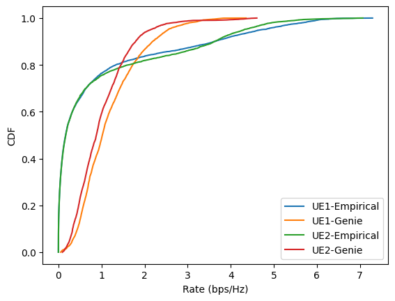

## Last week comments
- The objective function: the buffer penalty is repetitive with the communication part

- Consider the benchmark and debug the code that I already have. 
Consider what result should be presented.

- The ML model: cardinality of the action space and calculation of the reward.

---
### Code
Two Cars
Speed 36 km/h
TTI 10 ms second
Expected received SNR: 15 dB
Transmit power is distributed to each user equally. 

Empirical method: consider sensing beams also contains data stream.

If sensing beams do not contain data stream, the empirical method has bad performance. 80% of the rate is 0.

---

### Action space 
The action space is hybrid. 
$$
\begin{equation}
   a_n =   \{[\lambda_1, \cdots, \lambda_U], [\boldsymbol{f}_{1}, \cdots, \boldsymbol{f}_{U}], [P_1, \cdots, P_U]\} \in \mathcal{A} .
\end{equation}
$$
The actions are dependent.  

#### Consider discrete space
For beam alignment, it is difficult to determine the action space of $\boldsymbol{f}_1, \cdots, \boldsymbol{f}_U$, as each user can have one or multiple beams depending on $\lambda$. 

So, we consider to assign user to beams. 
Denote $\delta_{1}, \cdots, \delta_{N_t}$ for the $N_T$ beams' indicator. 
Let $\delta_{n_t,u} = 1$ denote that $u$-th user is assigned to $n_t$-th beam. 
$\sum_{u=1}^{U} \delta_{n_t,u} \in \{0, 1\}$, 0 means the beam is not assigned. A beam is only used for one user.
The action space is $N_t^{(U+1)}$. 
$\lambda$ is determined implicitly.

For the power, we consider the total power is divided to $M$ portion. 
The total number of beams in use is $N_t' = \sum_{u=1}^{U}\sum_{n_t=1}^{N_T} \delta_{n_t,u}$.
Distributing power action has $\binom{M-1}{N_t'-1}$, where $M$ is a tunable parameter.

#### Consider continuous space

Some work also makes the discrete space into continuous.
- Make the action space all continuous by using a softmax layer.
- $\hat{\delta}_{n_t} \in [0, 1]$, and the assigned beam is $\lceil\hat{\delta}*U\rceil$-th user.
- Normalize the transmit power $\hat{P}_u\in[0,1]$ 

### Comments
- Reduce the action space
   - Relax the contraint that a beam can only be used by one user
   - Search in a set of beams by considering the largest area user can go calculated from its location and speed
   - The power can be calculated separately after beam assignment  