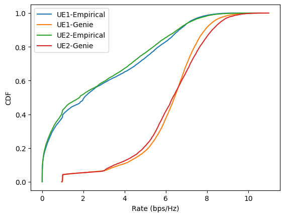
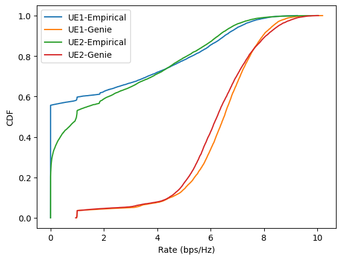

### July 18 Comments
- [x] Debug non-ML implementation
- [x] Reduce the action space
   - [x] Relax the constraint that a beam can only be used by one user
   - [x] Search in a set of beams by considering the largest area user can go calculated from its location and speed
- [ ] The power can be calculated separately after beam assignment  

---
### Non-ML Implementation
- Two Cars
- 28GHz
- Speed $\sim \mathcal{N}(30, 2)$
- TTI 10 ms second
- Expected received SINR at the user: 15 dB
- *Expected received SNR of the echos*: 0 dB -- estimation suffers from a bad performance
- Transmit power: distributed to each user equally.
$P_u = P_{tot}/U$
 If a user has multiple beams, $P_u$ is further distributed equally to each beam. 
 - LoS environment.

*Empirical method*: the BS estimates AoD from received echos. If the estimation error > beamwidth, the user is a sensing user. The BS assigns the beams according to $\hat{\theta}$ plus its two adjacent ones. 
*Genie method*: the BS knows CSI $\boldsymbol{h}_u$ and selects the beam that maximizes the received power for each user.

In the above result, sensing beams contain data stream.

If sensing beams do not contain data stream, the result is as follows.

---

### Action space 
The BS needs to extract features to tell 
- on which user to perform sensing
- which direction, i.e., the beam and the power to use that is most useful

The actions include 
$$
\begin{equation}
   a_n =   \{[\lambda_1, \cdots, \lambda_U], [\mathcal{C}_{1}, \cdots, \mathcal{C}_{U}]\} \in \mathcal{A} .
\end{equation}
$$
$\lambda_u$ --- User type, 1 denotes communication user, 0 denotes sensing user
$\mathcal{C}_{u}$ --- beam indices that are allocated for user $u$.
         The beamforming weight is $\boldsymbol{f}_u = \sum_{i\in\mathcal{C}_u} \mathbf{F}_{i,:}$, $\mathbf{F}$ is the codebook

- $P_u$ --- transmit power of allocated beams towards user $u$ is calculated after the agent has sampled the action.

#### Consider discrete action space

- Relax the constraint that a beam can only be used by one user
- Search in a set of beams by considering the largest area user can go calculated from its location and speed

<!-- **__Association:__** PPO algorithm's objective function set a clip reward function to avoid a big change in the policy. -->

For user $u$:

Case 1: $n-1$ TTI, $\lambda_{u,n-1} = 1$, and the beam index is $\mathcal{C}_{u, n-1}$ (the indix of the selected beam) 
   - $n$ TTI, $\lambda_{u,n} = 1$, the beam $\mathcal{C}_{u, n} = \mathcal{C}_{u, n-1}$
   - $n$ TTI, $\lambda_{u,n} = 0$, the beam can be    
      - $\mathcal{C}_{u, n} = \mathcal{C}_{u, n-1} + [-2,-1,0]$
      - $\mathcal{C}_{u, n} = \mathcal{C}_{u, n-1} + [-1,0,1]$
      - $\mathcal{C}_{u, n} = \mathcal{C}_{u, n-1} + [0, 1, 2]$

Case 2:  $n-1$ TTI, $\lambda_{u,n-1} = 0$, and the beam is $\mathcal{C}_{u, n-1}$ (the indices of the selected beams)
   - $n$ TTI, $\lambda_{u,n} = 1$, the beam $\mathcal{C}_{u, n}$ is the beam from the estimation result
   - $n$ TTI, $\lambda_{u,n} = 0$, the beam $\mathcal{C}_{u, n}$ needs to cover more area
      - $\mathcal{C}_{u, n} = min(\mathcal{C}_{u, n-1}) + [-2,-1,0]$
      - $\mathcal{C}_{u, n} = min(\mathcal{C}_{u, n-1}) + [-1,0, 1]$
      - $\mathcal{C}_{u, n} = max(\mathcal{C}_{u, n-1}) + [-1,0,1]$
      - $\mathcal{C}_{u, n} = max(\mathcal{C}_{u, n-1}) + [0, 1, 2]$

Case 1 can be expressed the same as case 2. 

Therefore, for each user, the action tuple $[\lambda, \mathcal{C}]$ has 5 options. $U$ users' actions have $ \textrm{action\_dim} = 5U$. 

While taking user's velocity into consideration, the maximum moving distance with respect to the BS is $v\cdot dt$. The span of beams is $\lceil \frac{\arctan (vdt/d)}{beamwidth}\rceil$ where $d $ is the distance between user and BS. In order to cover these area, the cardinality of action for the sensing case, i.e., $\lambda=0$, is $2\lceil \frac{\arctan (vdt/d)}{beamwidth}\rceil +1$. However, in the implementation, we can fix the scan range to be a constant.

The power allocation will be calculated individually when adopting an action.

<!--
For the actor network, allocating resouces to different users can be done by spliting the actor network to sub-nets. 

For the power, we consider the total power is divided to $M$ portion. 
The total number of beams in use is $N_t' = \sum_{u=1}^{U}\sum_{n_t=1}^{N_T} \delta_{n_t,u}$.
Distributing power action has $\binom{M-1}{N_t'-1}$, where $M$ is a tunable parameter.
-->

---

The objective function is
$$
\begin{alignat}{2}
&\arg \max_{\lambda, \boldsymbol{f}, P} && \sum_{n=1}^{N} \sum_{u=1}^U \left(\lambda_{u,n}\mathbf{1}_{(B_{u,n} > 0)} R_{u,n} + (1-\lambda_{u,n}) (1- \text{var}^{no}(\hat{\varphi}_{q,n})) 
%- \frac{B_{u,n }- R_{u,n}}{B_{u,0}} 
\right) \\
&\mathrm{subject~to} ~~ &&\sum_{u=1}^U P_{u,n} \leq P \nonumber \\
& &&\lambda_{u,n} \in\{0,1\} ~~ \text{user's state: 1=CU, 0= SU}\nonumber\\
& && \text{var}^{no}(\hat{\varphi}_{q,n}) ~~ \text{normalized MSE,}  \nonumber \\
& &&  \text{var} (\hat{\varphi}_{q,n}) \propto \frac{\sigma_{\omega}^2}{\kappa^2 P_{q,n} \beta^2_{q,n} \big|\boldsymbol{a}^H (\varphi_q) \boldsymbol{f}_{q,n}\big|^2 \Delta T } \nonumber \\
%& && B_{u,n} = B_{u,n-1} - R_{u, n-1}
\end{alignat}
$$
$R_{u,n}$, indicating if a packet went through, is defined as
$$
\begin{align}
& R_{u,n} = \mathbf{1}_{(\log (1 + \gamma_{u,n})> c) \cap (\text{var}(\hat{\varphi}_u) \leq th) }
 \\ 
= & \begin{cases} 1, (\log (1 + \gamma_{u,n})> c) \cap (\text{var}(\hat{\varphi}_u) \leq th)\\
0, (\text{var}(\hat{\varphi}_u) > th) \cup (\log (1 + \gamma_{u,n})<c)\cap(\text{var}(\hat{\varphi}_u))
\end{cases}
\end{align}
$$

<!--
> **Note**
> Adding buffer penalty prioritize data transmission when the buffer is not empty. 

- What value should be set for the outage probability？ 
- Optimize the power allocation when beams and types of users are set.  

**Reward**
The BS should prioritize sending out a packet from the data buffer.

Sensing: The sensing reward needs to be scaled to be comparable with the communication reward.

$if~\text{var}^no(\hat{\varphi}_u) < th $, 
$~~~~~~~$reward = 1. 
-->

---
### RL model

- **Input**: Env: $\boldsymbol{Y}$, $\boldsymbol{B}= [B_1, \cdots, B_U]$, previous beam allocation $[\mathcal{C}_{1,n-1}, \cdots, \mathcal{C}_{U,n-1}]$, $\mathbb{A}(\bar{\boldsymbol{\omega}}^a)$

- **Output** Two neural networks, *actor network* $\mathbb{A}(\bar{\boldsymbol{\omega}}^a)$ and *critic network* $\mathbb{C}(\bar{\boldsymbol{\omega}}^c)$ which are parameterized by $\bar{\boldsymbol{\omega}}^a$ and $\bar{\boldsymbol{\omega}}^c$, respectively.

**State**: is the number of packets in the buffer, the estimation precision which will determine the BS resources allocation.  
$$
\begin{equation}
    s_n  = \{[B_{1}, \cdots, B_{U}], [\mathcal{C}_{1,n-1}, \cdots, \mathcal{C}_{U,n-1}],[\mathbf{Y}]\} \in \mathcal{S}.
\end{equation}
$$

> Note 
Instead of $\boldsymbol{Y}$, the state can be the beamforming output of the echos associated with user $u$-th beamformer $\boldsymbol{b}_u = |\boldsymbol{f}_u^H \boldsymbol{Y}|^2$. It will be used for calculating the reward, seen from the objective function. And it decreases the $\mathrm{state\_ dim}$ to be $U*N$.

<!--
**Reward** is calculated according to the objective function. 
Advantage: how good the state is for the agent to be in  
Reward: how good the action is when the agent is at a state
-->

TODO
- [ ] Calculate power allocation. When users' type and beams are set, is it a convex problem to calculate the power alllocation?
- [ ] Check the estimation performance. See whether $\boldsymbol{b}_u = |\boldsymbol{f}_u^H \boldsymbol{Y}|^2$ can implicitly reflect the sensing performance.
