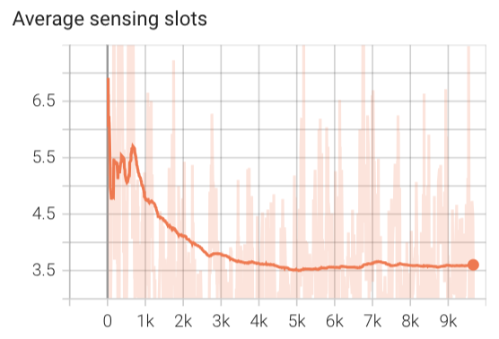
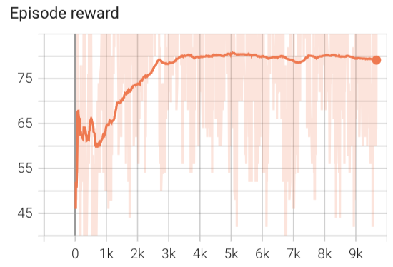
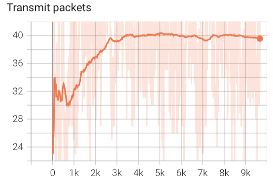

---
A BS optimizes the resource management in a multi-user communication network.
The BS decides the user type, beams, and power level for all the users.


### PPO-based method

**Action**

The actions include 
$$
\begin{equation}
   a_n =   \{[\lambda_1, \cdots, \lambda_U], [\mathcal{C}_{1}, \cdots, \mathcal{C}_{U}]\} \in \mathcal{A} .
\end{equation}
$$
$\lambda_u$ --- User type, 1 denotes communication user, 0 denotes sensing user
$\mathcal{C}_{u}$ --- beam indices that are allocated for user $u$.
         The beamforming weight is $\boldsymbol{f}_u = \sum_{i\in\mathcal{C}_u} \mathbf{F}_{i,:}$, $\mathbf{F}$ is the codebook

##### Shrink the action space
For user $u$:

Case 1: $n-1$ TTI, $\lambda_{u,n-1} = 1$, and the beam index is $\mathcal{C}_{u, n-1}$ (the indices of the selected beam) 
   - $n$ TTI, $\lambda_{u,n} = 1$, the beam $\mathcal{C}_{u, n} = \mathcal{C}_{u, n-1}$
   - $n$ TTI, $\lambda_{u,n} = 0$, the beam can be    
      - $\mathcal{C}_{u, n} = \mathcal{C}_{u, n-1} + [-2,-1,0]$
      - $\mathcal{C}_{u, n} = \mathcal{C}_{u, n-1} + [-1,0,1]$
      - $\mathcal{C}_{u, n} = \mathcal{C}_{u, n-1} + [0, 1, 2]$

Case 2:  $n-1$ TTI, $\lambda_{u,n-1} = 0$, and the beam is $\mathcal{C}_{u, n-1}$ (the indices of the selected beams)
   - $n$ TTI, $\lambda_{u,n} = 1$, the beam $\mathcal{C}_{u, n}$ is the beam that maximizes the beamforming output of the received echo 
   - $n$ TTI, $\lambda_{u,n} = 0$, the beam $\mathcal{C}_{u, n}$ needs to cover more area
      - $\mathcal{C}_{u, n} = min(\mathcal{C}_{u, n-1}) + [-2,-1,0]$
      - $\mathcal{C}_{u, n} = min(\mathcal{C}_{u, n-1}) + [-1,0, 1]$
      - $\mathcal{C}_{u, n} = max(\mathcal{C}_{u, n-1}) + [-1,0,1]$
      - $\mathcal{C}_{u, n} = max(\mathcal{C}_{u, n-1}) + [0, 1, 2]$

When a user is sensing user, the BS allocates some adjacent beams of its previous TTI's to enlarge its sweeping area. 
Action space dimension: $5^U$

---

### State
Instead of $\boldsymbol{Y}$, the state can be the beamforming output of the echos associated with user $u$-th beamformer $\boldsymbol{b}_u = |\boldsymbol{f}_u^H \boldsymbol{Y}|^2$. 

- The BS takes $\|\boldsymbol{b}_{u,n}\|^2$ as the state. 
```
self.observation_space = gym.spaces.Box(low=0, high=np.inf, 
                shape=(self.number_of_antennas, self.N_samples))
``` 

### Reward:
1. The number of successfully transmitted packets.
I didn't take the sensing part into consider tation.


### Simulation environment


| Parameter |Symbol | Value | 
|---|---|---|
| BS antennas |$𝑀_𝑡$| 32 |
|Frequency |$𝑓_𝑐$| 28 GHz |
|Tx Power |$𝑃_𝑡$| 15 dBm |
|Noise Power| $\sigma_{\omega}^2$| 109 dBm|
|Time duration of a TTI| dt| 10 ms|
|Beamwidth|| $\approx 4^{\degree}$|
|User Signal-to-Noise Ratio | | around 15 dB |
|Scenario dimensions |SD| [100 x 100]|
| Number of UEs |$U$| 2 |
|Packet arrival probability | | $\sim$ binomial(100,0.6)|
|UEs initial positions [(x, y) permute] |$[[𝑥^𝑢_0, 𝑦^𝑢_0]]$ | $[24.,61.],[95.,30.]$|
|User speed during a slot|$v$|$\sim N(20,4)$ |
|Number of TTI per episode |$𝐾$| 100 |
|Number of training episodes |$𝐸_{train}$| 9000 |

Every episode I initialized user postions randomly, 

### KPI 
- Lost packets: at the end of the frame, the un-transmitted packets
   ```
         datapool.sum()
   ```

- Averaged packet waiting time to be transmitted: the number of TTIs that is assigned as sensing before its transmission




x_axis = test episode

Episode reward and transmit packets are equivalent because of the reward setting.

2. The sensing part should be taken into consideration. The sensing part measures whether the multiple beams cover the user or not. If it covers, in the next TTI, it can select a beam that can transmit a packet.
A packet is transmitted: reward = 2
A proper set of sensing beams is selected, reward = 1

Current state: the model does not converge.