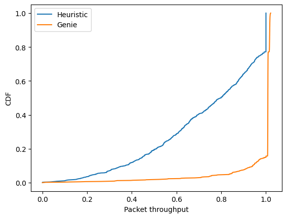
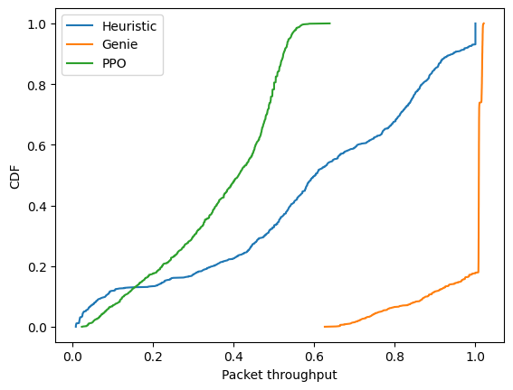
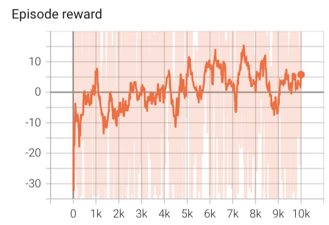
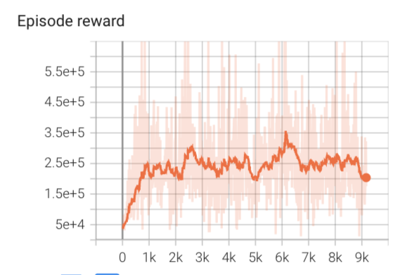
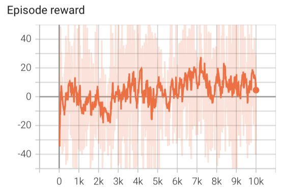
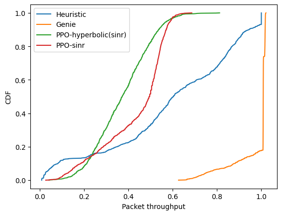

### Aug 29 comments
- The reward which sums up the weighted SINR of communication and sensing parts does not reflect the throughput maximization. 
- Add the hyperbolic tagent function to scale the SINR(scalar) to be large than 15 as a fixed rate of 4 is considered

<!--
#### Results update
Cleared one bug in the code.
Packet throughput is defined as the percentage of successfully transmitted packets in one episode. 
This is the non-RL algorithms. 

-->
### Reward

**Reward attempt**

<!--
1. ppo_bm
 the hyperbolic function:
$$ r = \begin{cases} 1-e^{-A (x-c) }, x \ge c \\
y[y<-1] = -1, x<c
\end{cases}
$$
For communication and sensing, $c = 15$ and $4$ respectively.
$A =1 $. -->
   <!-- /Users/xiyu/Documents/AAU/CENTRIC_codes/PPO_preTrained/BeamManagementEnv-v1/PPO_BeamManagementEnv-v1_0_9.pth -->
<!-- 

-->

- use sinr of users to calculate the reward
$r = \sum_{u=1}^{U} 0.75* \lambda_u (sinr -15) + 0.25* (1-\lambda_u) (sinr-4)$

- add the hyperbolic tangent function of SINR 
$$f(x = sinr;A,c) = \begin{cases} 1-e^{-A (x-c) }, x \ge c \\
e^{A(x-c)} - 1, x<c
\end{cases}
$$ 
Reward calculation
$$
   r = \sum_{u=1}^{U} 0.75* \lambda_u (f(sinr; 1,15) ) + 0.25* (1-\lambda_u) (f(sinr; 1, 4))
$$

<!-- /Users/xiyu/Documents/AAU/CENTRIC_codes/PPO_preTrained/BeamManagementEnv-v1/PPO_BeamManagementEnv-v1_0_10.pth -->

For communication and sensing, $c = 15$ and $4$ respectively.
$A =1 $.

**Will try in the following days:**
- Add a penalization when $x>c$ so that the SINR will not have an explosion.

- For the sensing part, till now I am using SINR to compare. I will use 