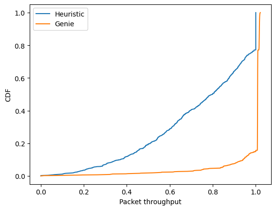
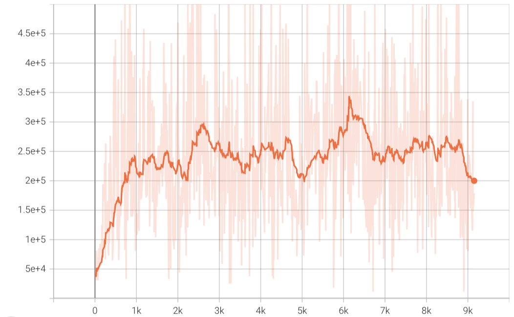
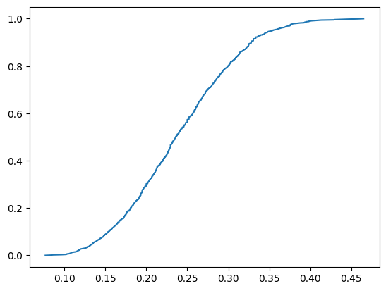
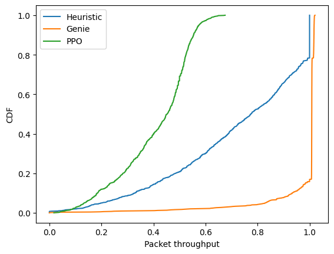
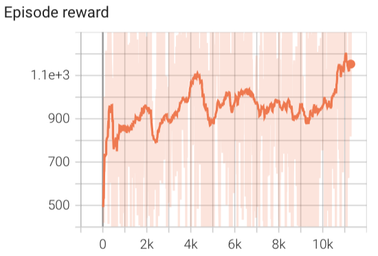
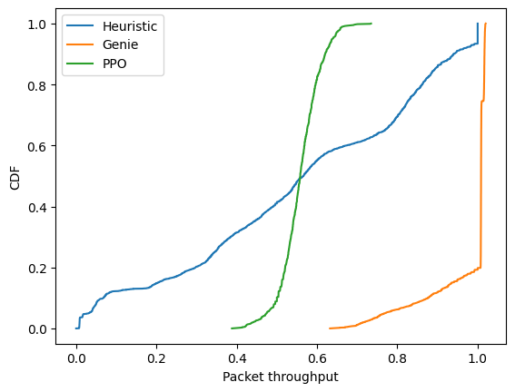

### Aug 22 comments
- Use SINR to calculate reward
- Check the reward definition in ISAC literature  
---
<!--
#### Results update
Cleared one bug in the code.
Packet throughput is defined as the percentage of successfully transmitted packets in one episode. 
This is the non-RL algorithms. 

-->
### Reward
* In JSAC setup, if a user is both communication user and sensing user at the same time, the reward of a user is communication part subtracting the sensing part of all users. Or according to the objective function, the reward is the objective subtracting the constraints.


* In out setup, a user is either a communication user or a sensing user. Reward of a user at each step (TTI) depends on its type.  

$$r = \sum_{u=1}^{U} \omega_c \lambda_u r_s + \omega_s  (1 - \lambda_u) r_c$$

The two weights are to balance the relative importance of communication and sensing functions.
The individual reward is linked to the corresponding beamforming output $\boldsymbol{b}_u$ or users' SINR.

$r_s$ encourages the BS to maximize the SNR to the intended user.

$r_c$ should encourage the BS to send sensing beams to users that are useful to them, that is, it can reflect the importance of sensing


**Reward attempt**

1. use sinr of users to calculate the reward
$r = \sum_{u=1}^{U} 0.75* \lambda_u (sinr -15) + 0.25* (1-\lambda_u) (sinr-5)$

<!-- /runs/PPO_BeamManagementEnv-v1_run_1 -->
Reward: the model converged

CDF of throughput: 
*Throughput is defined as the percentage of successfully transmitted packets among the generated total packets in one episode.*

However, the throughput is low compared to the non-RL methods.


2. Changes: the value to which SINR is compared
<!-- 08-27 09:50 /Users/xiyu/Documents/AAU/CENTRIC_codes/PPO_preTrained/BeamManagementEnv-v1/PPO_BeamManagementEnv-v1_0_0.pth --> 
$r = \sum_{u=1}^{U} 0.75* \lambda_u (sinr -11) + 0.25* (1-\lambda_u) (sinr-3)$



*Heuristic:* The BS estimates the AoDs from echos, and assign user type and beams according to the estimates. 
*Genie:* The BS knows the CSI of each user.

3. Changes: Users' initial positions are fixed to 6 options.
<!-- 08-27 17:40 /Users/xiyu/Documents/AAU/CENTRIC_codes/PPO_preTrained/BeamManagementEnv-v1/PPO_BeamManagementEnv-v1_0_1.pth-->




4. Changes: introduce a weight for sensing using historical information
Take the history information into consideration
$\boldsymbol{b}_{u,n-2} - \boldsymbol{b}_{u,n-1}$ shows the variation of the reflected signal power, which also shows the importance of sensing.
When it is high, sensing has a higher weight. Set the sensing weight $\omega_s= \text{sigmoid}(\boldsymbol{b}_{u,n-2} - \boldsymbol{b}_{u,n-1})$
$r = \sum_{u=1}^{U} \lambda_u \sqrt{\boldsymbol{b}_u} + \omega_s (1-\lambda_u) \sqrt{\boldsymbol{b}_u}$
 $r = \sum_{u=1}^{U} \lambda_u (sinr -12) + \omega_s (1-\lambda_u) (sinr-6)$

However, the throughput is less than 50%.


### PPO-based method

**Action**

The actions include 
$$
\begin{equation}
   a_n =   \{[\lambda_1, \cdots, \lambda_U], [\mathcal{C}_{1}, \cdots, \mathcal{C}_{U}]\} \in \mathcal{A} .
\end{equation}
$$
$\lambda_u$ --- User type, 1 denotes communication user, 0 denotes sensing user
$\mathcal{C}_{u}$ --- beam indices that are allocated for user $u$.
         The beamforming weight is $\boldsymbol{f}_u = \sum_{i\in\mathcal{C}_u} \mathbf{F}_{i,:}$, $\mathbf{F}$ is the codebook

##### Shrink the action space
For user $u$:

Case 1: $n-1$ TTI, $\lambda_{u,n-1} = 1$, and the beam index is $\mathcal{C}_{u, n-1}$ (the indices of the selected beam) 
   - $n$ TTI, $\lambda_{u,n} = 1$, the beam $\mathcal{C}_{u, n} = \mathcal{C}_{u, n-1}$
   - $n$ TTI, $\lambda_{u,n} = 0$, the beam can be    
      - $\mathcal{C}_{u, n} = \mathcal{C}_{u, n-1} + [-2,-1,0]$
      - $\mathcal{C}_{u, n} = \mathcal{C}_{u, n-1} + [-1,0,1]$
      - $\mathcal{C}_{u, n} = \mathcal{C}_{u, n-1} + [0, 1, 2]$

Case 2:  $n-1$ TTI, $\lambda_{u,n-1} = 0$, and the beam is $\mathcal{C}_{u, n-1}$ (the indices of the selected beams)
   - $n$ TTI, $\lambda_{u,n} = 1$, the beam $\mathcal{C}_{u, n}$ is the beam that maximizes the beamforming output of the received echo 
   - $n$ TTI, $\lambda_{u,n} = 0$, the beam $\mathcal{C}_{u, n}$ needs to cover more area
      - $\mathcal{C}_{u, n} = min(\mathcal{C}_{u, n-1}) + [-2,-1,0]$
      - $\mathcal{C}_{u, n} = min(\mathcal{C}_{u, n-1}) + [-1,0, 1]$
      - $\mathcal{C}_{u, n} = max(\mathcal{C}_{u, n-1}) + [-1,0,1]$
      - $\mathcal{C}_{u, n} = max(\mathcal{C}_{u, n-1}) + [0, 1, 2]$

When a user is sensing user, the BS allocates some adjacent beams of its previous TTI's to enlarge its sweeping area. 
Action space dimension: $5^U$

---

### State
Instead of $\boldsymbol{Y}$, the state can be the beamforming output of the echos associated with user $u$-th beamformer $\boldsymbol{b}_u = |\boldsymbol{f}_u^H \boldsymbol{Y}|^2$. 

- The BS takes $\|\boldsymbol{b}_{u,n}\|^2$ as the state. 
```
self.observation_space = gym.spaces.Box(low=0, high=np.inf, 
                shape=(self.number_of_antennas, self.N_samples))
``` 

### Reward:
1. The number of successfully transmitted packets.
I didn't take the sensing part into consider tation.


### Simulation environment


| Parameter |Symbol | Value | 
|---|---|---|
| BS antennas |$𝑀_𝑡$| 32 |
|Frequency |$𝑓_𝑐$| 28 GHz |
|Tx Power |$𝑃_𝑡$| 15 dBm |
|Noise Power| $\sigma_{\omega}^2$| 109 dBm|
|Time duration of a TTI| dt| 10 ms|
|Beamwidth|| $\approx 4^{\degree}$|
|User Signal-to-Noise Ratio | | around 15 dB |
|Scenario dimensions |SD| [100 x 100]|
| Number of UEs |$U$| 2 |
|Packet arrival probability | | $\sim$ binomial(100,0.6)|
|UEs initial positions [(x, y) permute] |$[[𝑥^𝑢_0, 𝑦^𝑢_0]]$ | $[24.,61.],[95.,30.]$|
|User speed during a slot|$v$|$\sim N(20,4)$ |
|Number of TTI per episode |$𝐾$| 100 |
|Number of training episodes |$𝐸_{train}$| 9000 |

Every episode I initialized user postions randomly, 

### KPI 
- Throughput: at the end of the frame, the percentage of transmitted packets


- Lentency: Averaged packet waiting time to be transmitted: the number of TTIs that is assigned as sensing before its transmission


