### Reward attempt

**1 .**  Maximize SINR in linear scale
$r = \sum_{u=1}^{U} 0.75* \lambda_u (sinr -15) + 0.25* (1-\lambda_u) (sinr-5)$
<!-- /runs/PPO_BeamManagementEnv-v1_run_1 -->
Reward: the model converged
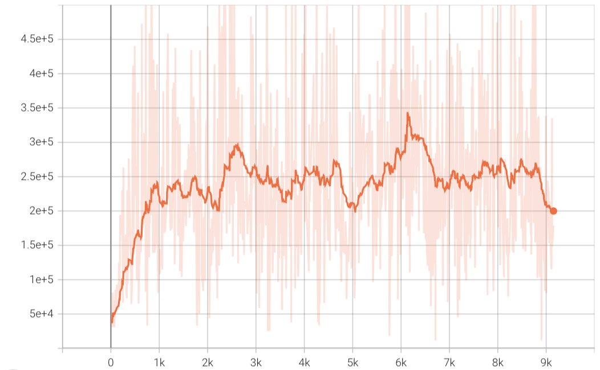 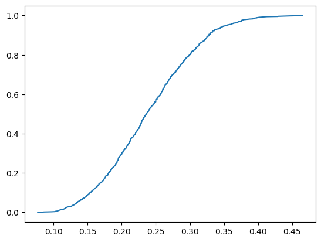

CDF of throughput: 
*Throughput is defined as the percentage of successfully transmitted packets among the generated total packets in one episode.*

However, the throughput is low compared to the non-RL methods.

---
**2 .**  Changes: the value to which SINR is compared, sinr in linear scale
<!-- 08-27 09:50 /Users/xiyu/Documents/AAU/CENTRIC_codes/PPO_preTrained/BeamManagementEnv-v1/PPO_BeamManagementEnv-v1_0_0.pth --> 
$r = \sum_{u=1}^{U} 0.75* \lambda_u (sinr -11) + 0.25* (1-\lambda_u) (sinr-3)$

<!--
**3 .** Changes: Users' initial positions are fixed to 6 options.
<!-- 08-27 17:40 /Users/xiyu/Documents/AAU/CENTRIC_codes/PPO_preTrained/BeamManagementEnv-v1/PPO_BeamManagementEnv-v1_0_1.pth-->
<!-- 

-->

---
**Hyperbolic function:**

$$f(x = sinr;A,c) = \begin{cases} 1-e^{-A (x-c) }, x \ge c \\
e^{A(x-c)} - 1, x<c
\end{cases}
$$ 
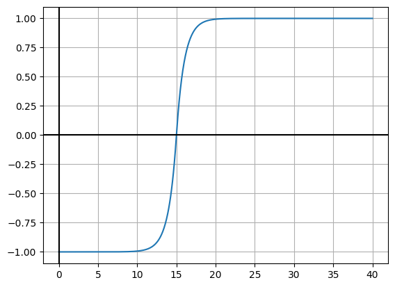

**4.** Use the function of SINR
$$
r = \sum_{u=1}^{U} \lambda_u \log_2(1 + sinr)f(sinr[dB],A=1,c=12) + (1-\lambda_u) f(sinr, 1, 4) 
$$

**5.1** Use SINR and beamforming output
$$
r = \sum_{u=1}^{U} \lambda_u \log_2(1 + sinr)f(sinr[dB],A=1,c=12) + (1-\lambda_u) f(\boldsymbol{b}_u[dB], 1, 24) 
$$

Tried both the value linear scale and logarithm scale. 
Throughput: Bad! 0%-30%

**5.2** Without multiplying with log2 (1+sinr),  but with weights
$$
r = \sum_{u=1}^{U} 0.75 \cdot \lambda_u f(sinr[dB],A=1,c=12) + 0.25\cdot (1-\lambda_u) f(\boldsymbol{b}_u[dB], 1, 24) 
$$
<!--PPO_preTrained/BeamManagementEnv-v1/PPO_BeamManagementEnv-v1_0_14.pth-->
 
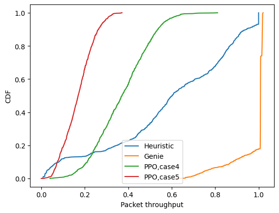

---

**6.**

$$r = \sum_{u=1}^{U} 0.75* \lambda_u (sinr[dB] -12) + 0.25* (1-\lambda_u) (\boldsymbol{b}_u[dB]-20)$$ 
<!--/Users/xiyu/Documents/AAU/CENTRIC_codes/PPO_beam_management/Multi-user-BM/saved_policy/PPO_preTrained/PPO_BeamManagementEnv-v1_0_15.pth-->
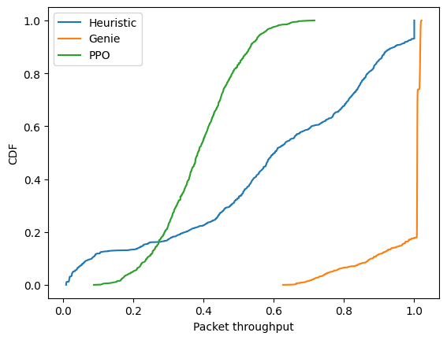
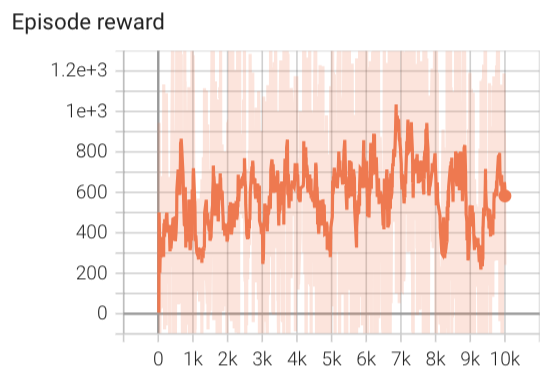

<!--
- SINR distribution
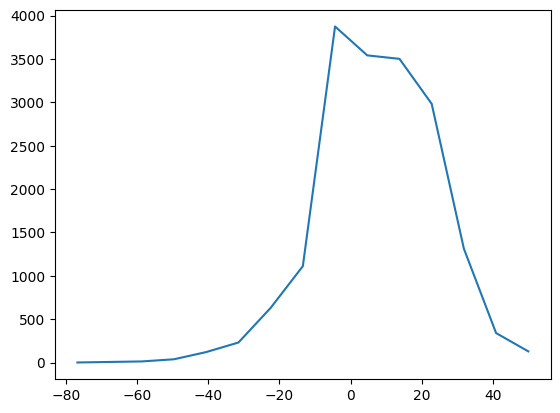 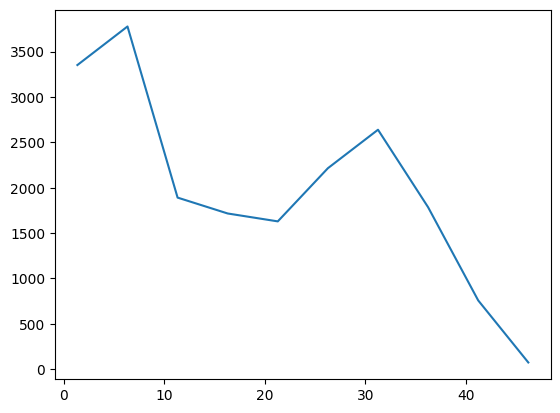
Left figure : histogram of SINR[dB]. Right figure: histogram of beamforming output[dB]

 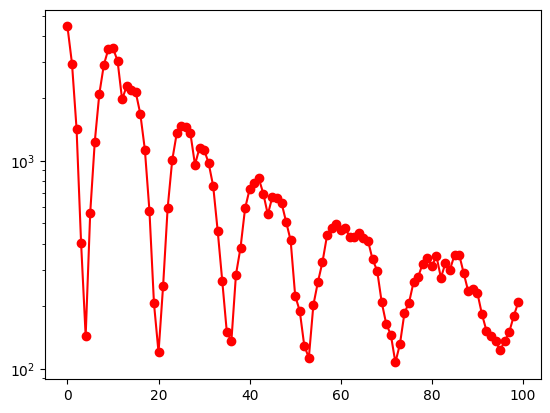
Left figure: y-axis is CRLB, x-asix is steps
Right figure: y-axis is beamforming output $\boldsymbol{b}_u$
When $\boldsymbol{b}_u >= 2\cdot 10^2$, CLRB is in an acceptable range.
-->
## Comments:
##### CDF of SINR
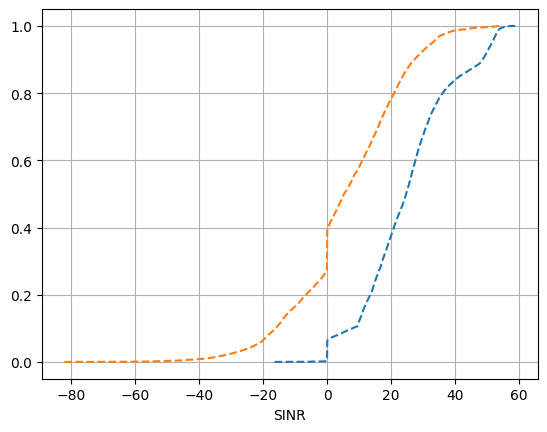

----: SINR of genie beam allocation
----: SINR of heuristic beam allocation

##### Do NOT consider sensing in the reward
**7.** Linear function of SINR[dB]
<!-- Time-09061345
saved_policy/PPO_preTrained/PPO_BeamManagementEnv-v1_0_16.pth-->
'''reward = np.sum((sinr-13) * self.ue_type )'''

> Suspect: this will only yield the throughput to be 50%. Maybe the agent will push all the resource to one user and transmit all of its packets. 

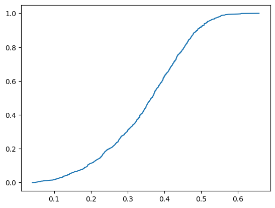  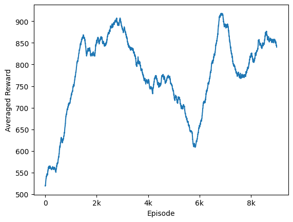 

---

**8.** Without a penalization at high SINR 
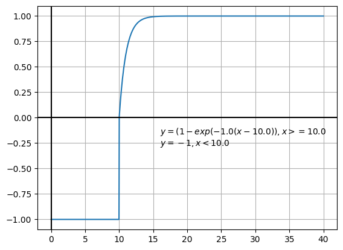 

<!--saved_policy/PPO_preTrained/BeamManagementEnv-v1/PPO_BeamManagementEnv-v1_0_17.pth -->

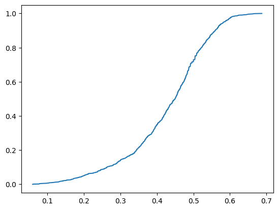  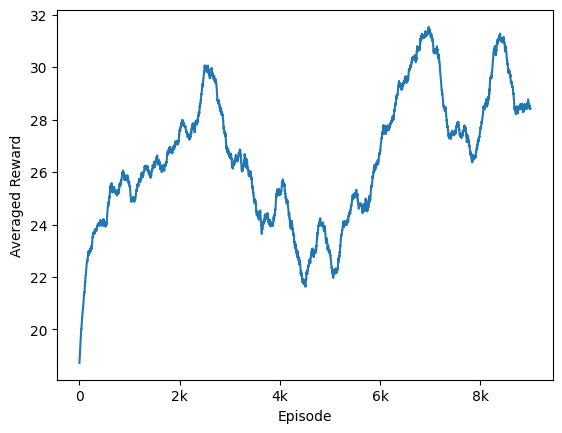

**9.** Add a penalization and use SINR
<!-- saved_policy/PPO_preTrained/PPO_BeamManagementEnv-v1_0_18.pth -->
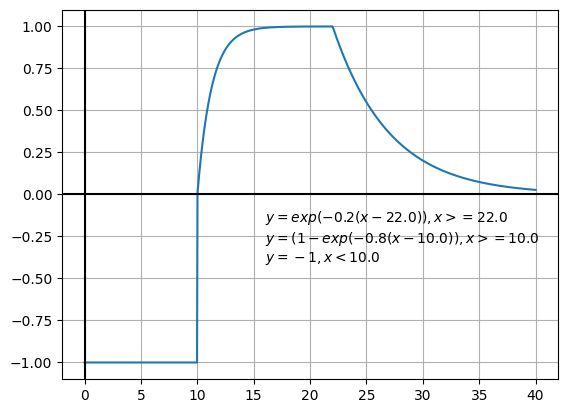
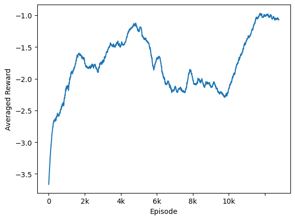   

*The throughput is lower than 10%!* The reward is negative.
Often times, users' SINRs fall in the range that f(SINR) is close to 0 or -1.
In a two-user case, both users have low SINR. The reason can be that the beam allocation is away from their true beam. Both of them need a high power in order to fullfil their requirement. $\mathbb{1}_{P_u \xi_u > \iota}$. On the other hand, the power allocation assigns power to only one user. 

One user has high SINR and the other has low SINR. The happens when two users are close. There is a high multi-user interference. 

**10. User SNR instead of SINR.**

> **Change** Calculating SNR instead of SINR of each user. And did not take the multi-user interference into consideration.

- reward is the hyperbolic function of SNR. 
/PPO_preTrained/BeamManagementEnv-v1/PPO_BeamManagementEnv-v1_0_12.pth

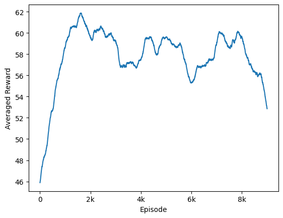  <!-- 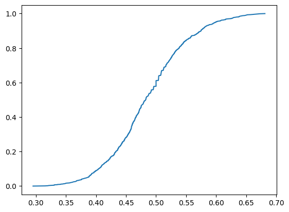 -->
 hyper_sinr_commu = hyperbolic_func(sinr,  1, 0.4, 10) #snr in dB
reward = np.sum(hyper_sinr_commu * self.ue_type )

- add a penalization at high SNR
   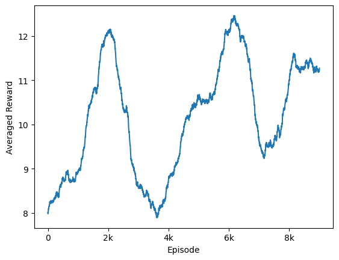

<!-- saved_policy/PPO_preTrained/PPO_BeamManagementEnv-v1_0_13.pth -->

**11.** User SINR and multiuser Interference
$$ r = \sum_{u=1}^U 3*(sinr[dB] - 8)* \lambda_u - 0.1 (Interference[dB] - 35)$$
<!-- saved_policy/PPO_preTrained/PPO_BeamManagementEnv-v1_0_11.pth -->
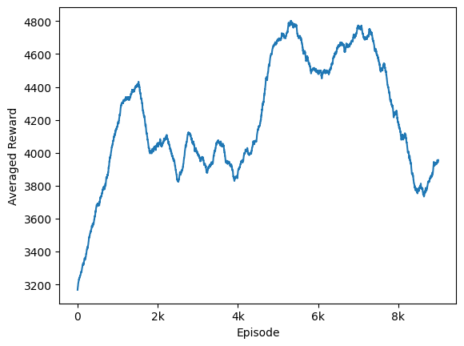

Checked the trained policy, the averaged SINR is lower than 8. But the reward is high. The power is only allocated to one user, causing the user has ~50 SINR. This increases the reward. 

**12.** Change the value 

##### A comparison of the above attempts.
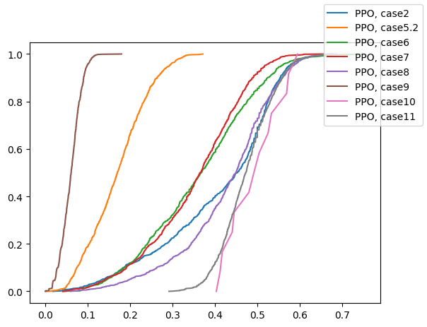

### TODO
- MSE as a function of time

- The power allocation for users is wrong in the sense that it can prioritize the communication.

Using SINR to calculate reward, the agent will learn a policy that maximizes the SINR. SINR depends on power allocation and the beam selection. The agent can only allocate the beam. If two users' beams are close, there is a high interference which reduces the SINR. But an allocation of separate beams will favor the user which is closer. 

The current RL method cannot be compared with the heuristic method because, the RL method takes the beamforming output as the observation while the heuristic takes the AoD estimates. 

##### Check the X-TDMA 
$X$-TDMA denotes that the BS assign a sensing slot of every user before every $X$ communication slots. 
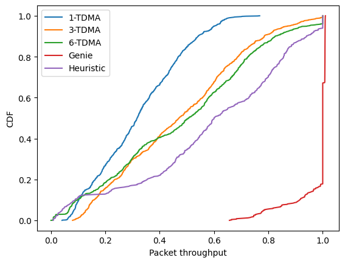 

The figure below shows the ratio of sensing slots among 100 steps.
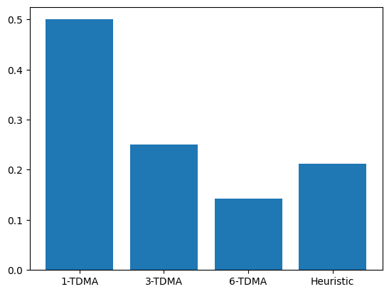 

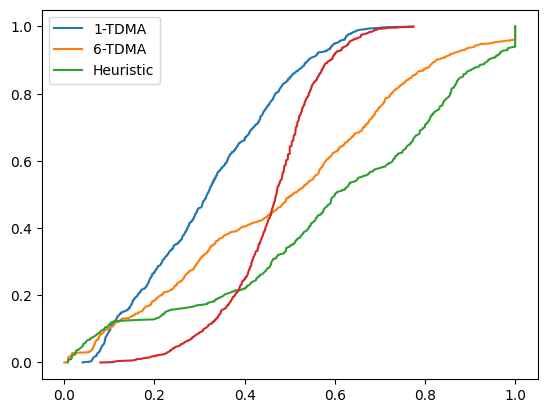 

##### Check the SINR distribution of the trained RN

##### Lower the value