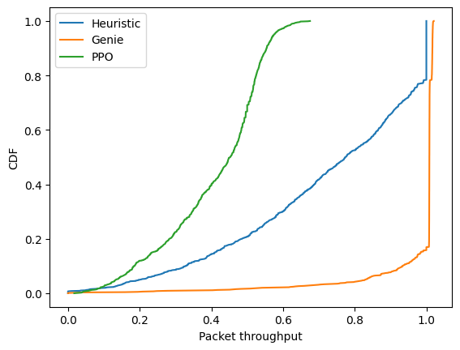
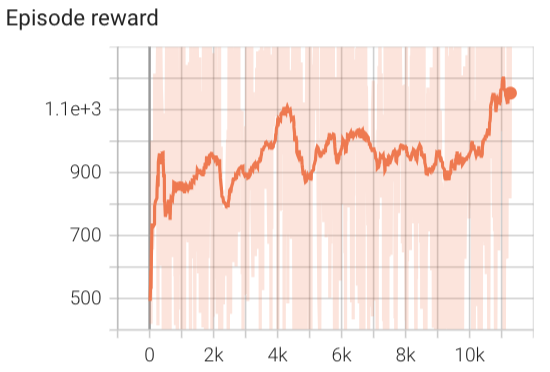
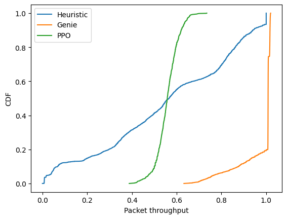
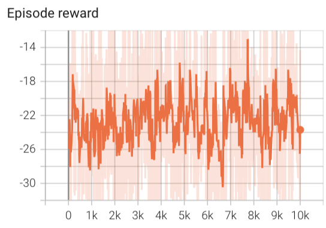
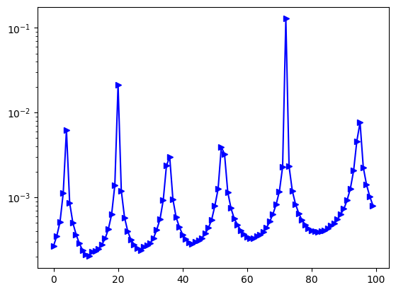

### Reward attempt

1. Maximize SINR in linear scale
$r = \sum_{u=1}^{U} 0.75* \lambda_u (sinr -15) + 0.25* (1-\lambda_u) (sinr-5)$
<!-- /runs/PPO_BeamManagementEnv-v1_run_1 -->
Reward: the model converged
 
CDF of throughput: 
*Throughput is defined as the percentage of successfully transmitted packets among the generated total packets in one episode.*

However, the throughput is low compared to the non-RL methods.

---
2. Changes: the value to which SINR is compared, sinr in linear scale
<!-- 08-27 09:50 /Users/xiyu/Documents/AAU/CENTRIC_codes/PPO_preTrained/BeamManagementEnv-v1/PPO_BeamManagementEnv-v1_0_0.pth --> 
$r = \sum_{u=1}^{U} 0.75* \lambda_u (sinr -11) + 0.25* (1-\lambda_u) (sinr-3)$

---
3. Changes: Users' initial positions are fixed to 6 options.
<!-- 08-27 17:40 /Users/xiyu/Documents/AAU/CENTRIC_codes/PPO_preTrained/BeamManagementEnv-v1/PPO_BeamManagementEnv-v1_0_1.pth-->

---
**Hyperbolic function:**

$$f(x = sinr;A,c) = \begin{cases} 1-e^{-A (x-c) }, x \ge c \\
e^{A(x-c)} - 1, x<c
\end{cases}
$$ 

4. Use SINR
$$
r = \sum_{u=1}^{U} \lambda_u \log_2(1 + sinr)f(sinr[dB],A=1,c=12) + (1-\lambda_u) f(sinr, 1, 4) 
$$

5.1 Use SINR and beamforming output
$$
r = \sum_{u=1}^{U} \lambda_u \log_2(1 + sinr)f(sinr[dB],A=1,c=12) + (1-\lambda_u) f(\boldsymbol{b}_u[dB], 1, 24) 
$$

Tried both the value linear scale and logarithm scale. 
Throughput: Bad! 0%-30%

5.2 Without multiplying with log2 (1+sinr),  but with weights
$$
r = \sum_{u=1}^{U} 0.75 \cdot \lambda_u f(sinr[dB],A=1,c=12) + 0.25\cdot (1-\lambda_u) f(\boldsymbol{b}_u[dB], 1, 24) 
$$
<!--PPO_preTrained/BeamManagementEnv-v1/PPO_BeamManagementEnv-v1_0_14.pth-->
 

---

6. 

$$r = \sum_{u=1}^{U} 0.75* \lambda_u (sinr[dB] -12) + 0.25* (1-\lambda_u) (\boldsymbol{b}_u[dB]-20)$$ 
<!--/Users/xiyu/Documents/AAU/CENTRIC_codes/PPO_beam_management/Multi-user-BM/saved_policy/PPO_preTrained/PPO_BeamManagementEnv-v1_0_15.pth-->

- SINR distribution
 
Left figure : histogram of SINR[dB]. Right figure: histogram of beamforming output[dB]

 
Left figure: y-axis is CRLB, x-asix is steps
Right figure: y-axis is beamforming output $\boldsymbol{b}_u$
When $\boldsymbol{b}_u >= 2\cdot 10^2$, CLRB is in an acceptable range.